

  <button id="btn-en" class="lang-btn active" onclick="setLang('en')">🇬🇧 English</button>
  <button id="btn-fr" class="lang-btn" onclick="setLang('fr')">🇫🇷 Français</button>

Chatbots can be told how to talk: in simple or sophisticated English, in an upbeat or a critical tone, calmly or with some emotion. What we don't really know is whether they do it. This study looks at exactly that. You chat with a recruiter agent in a mock job interview, and each time it answers, you tell us which of two possible replies better shows the style the agent was asked to have.

You send 12 messages in total. You are not being tested here, the agent is, so there are no right or wrong answers. Everything is anonymous and voluntary, and you can stop at any time by closing the page.

<a href="#he-before">Before you start</a>
<a href="#he-steps">How a turn works</a>
<a href="#he-criteria">What to look for</a>
<a href="#he-stuck">If you're stuck</a>
<a href="#he-flag">Flagging a problem</a>
<a href="#he-know">Good to know</a>
<a href="#he-contact">Take part</a>
<a href="#he-about">About the research</a>

<figure class="he-fig">
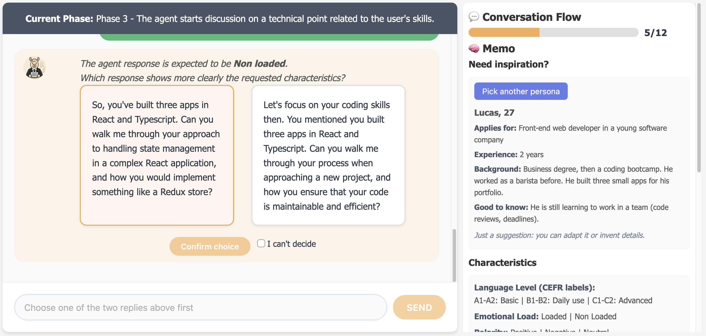
<figcaption>The screen during a turn. On the left, the chat, with the current phase on top and the two replies to compare. On the right, your progress and a memo you can check at any time.</figcaption>
</figure>

## Before you start {#he-before}

Read the information screen. A short "About you" form comes next (age range, English level, interview experience...). You can skip it, and the agent never sees your answers. Then tick the consent box, click **Start the interview** and give the page a moment to prepare the interview.

Only one person can take part at a time. If the page tells you someone else is already on it, come back in a few minutes.

<figure class="he-fig">
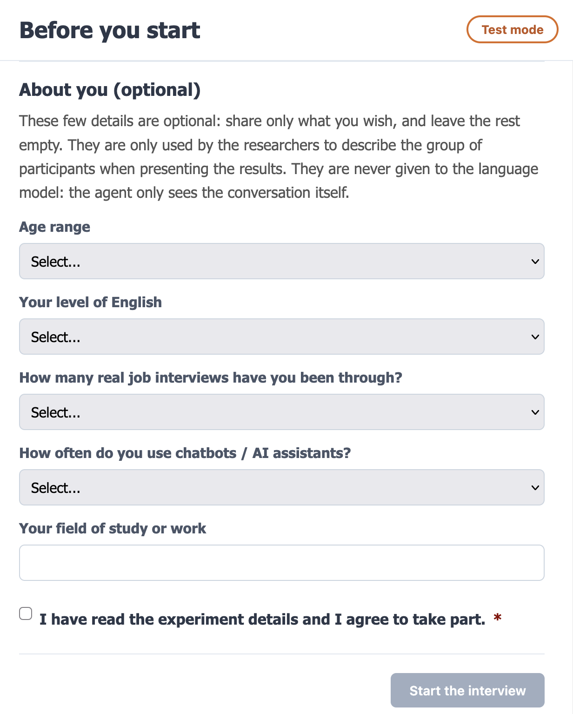
<figcaption>Fill in only what you wish, tick the consent box, then click <strong>Start the interview</strong>.</figcaption>
</figure>

## How a turn works {#he-steps}

1. Write your message and send it. Answer the way you would in a real interview, in a few sentences.
2. Wait for the agent, which can take anywhere from a few seconds to a few minutes. If you reload the page, your conversation is kept.
3. Above the two replies, a sentence tells you which style they should have, for example *"The agent response is expected to be Positive, Non loaded, B1."*
4. Read both replies. Which one is on the left or the right is random.
5. Click the one that shows this style more clearly, then click **Confirm choice**. The conversation goes on with the reply you picked.

<figure class="he-fig">

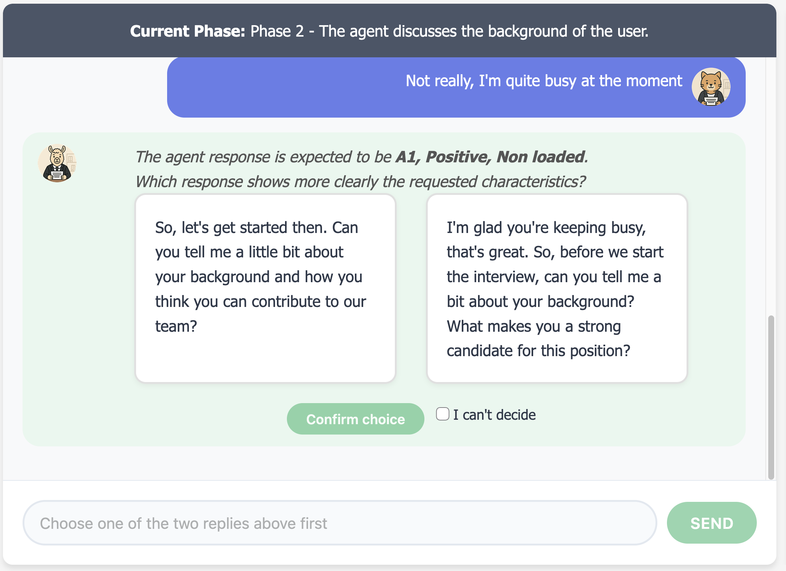
3
4
5

<figcaption>Steps 3 to 5 on screen: the requested style, the two replies, and the button to confirm.</figcaption>
</figure>

The agent leads the interview through five phases, and the current one is always displayed at the top of the chat. You don't need to follow them, just answer naturally.

<figure class="he-fig">
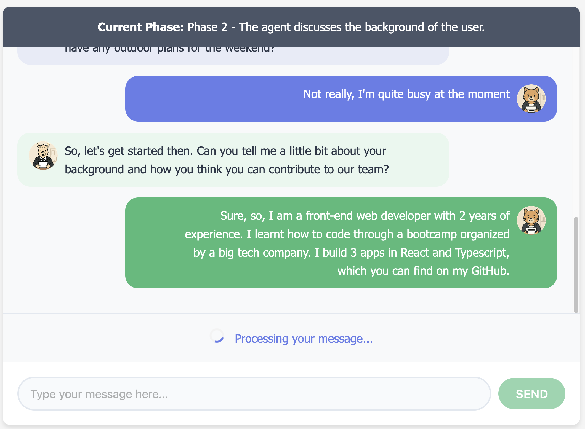
<figcaption>Phase 2: the banner names the current phase and the colours follow it. Here, your message is being processed (step 2).</figcaption>
</figure>
<figure class="he-fig">
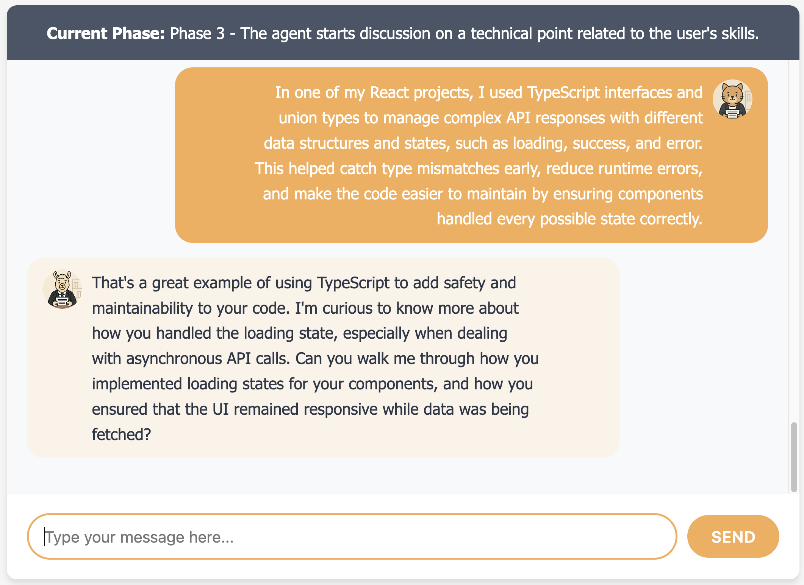
<figcaption>Later, in phase 3: the banner and the colours have changed. There is nothing for you to do.</figcaption>
</figure>

<button type="button" class="he-phase he-p1" aria-expanded="false" aria-controls="he-en-ph1">1 Greetings</button>
<button type="button" class="he-phase he-p2" aria-expanded="false" aria-controls="he-en-ph2">2 Background</button>
<button type="button" class="he-phase he-p3" aria-expanded="false" aria-controls="he-en-ph3">3 Technical point</button>
<button type="button" class="he-phase he-p4" aria-expanded="false" aria-controls="he-en-ph4">4 Short debate</button>
<button type="button" class="he-phase he-p5" aria-expanded="false" aria-controls="he-en-ph5">5 Send-off</button>

Click a phase for more details.

The agent welcomes you and makes some small talk to put you at ease. Answer as you would at the start of a real interview.

Typical messages:

<ul>
<li><em>"Hi, thanks for having me!"</em></li>
<li><em>"I'm doing well, a bit nervous but happy to be here."</em></li>
<li><em>"Am I at the right place for the interview?"</em></li>
</ul>

The agent asks about your studies and your professional experience. You can talk about real or made-up ones.

Typical message: <em>"I did a master's in marketing, then I spent two years in a small agency running social media campaigns."</em>

The agent asks a question about your skills and how you would handle a work situation. A few sentences are enough.

Typical messages:

<ul>
<li><em>"I usually start by listing priorities with the team, then I plan the work week by week and check progress regularly."</em></li>
<li><em>"In my last project, I trained a classifier on imbalanced data and used cross-validation to avoid overfitting."</em></li>
</ul>

The agent defends a point of view and you are free to agree, disagree or nuance. It doesn't matter whether what you say matches what you actually think.

Typical message: <em>"I see your point, but I think working in the office helps newcomers learn faster."</em>

The agent sums up the interview and wraps up the conversation. A polite closing message is all it takes.

Typical message: <em>"Thank you for your time, I enjoyed our discussion and I hope to hear from you soon."</em>

## What to look for {#he-criteria}

Each turn asks for one to three of the characteristics below, and you only judge the ones displayed. The question to keep in mind is which reply shows the requested style more clearly, whatever you would personally prefer. A friendly, well-written reply can still miss the target.

| Characteristic | Possible values | Description |
|---|---|---|
| Language level | A1, A2, B1, B2, C1, C2 | How sophisticated the English is, from basic (A1) to proficient (C2).<a href="#he-cefr-en">1</a> A1: familiar everyday expressions and very basic phrases. A2: simple sentences about everyday topics such as family, shopping or work. B1: clear standard language on familiar matters, able to describe experiences and give brief reasons and opinions. B2: clear, detailed text on a wide range of subjects, including abstract and technical ones, with viewpoints explained. C1: fluent, flexible and well-structured language on complex subjects, with implicit meaning. C2: virtually everything expressed with ease, very fluently and precisely, with fine shades of meaning. |
| Polarity | Positive, Negative, Neutral | The overall sentiment of the text, as in sentiment analysis: does the message sound positive, negative, or neither? |
| Emotional load | Loaded, Non loaded | Whether the text shows noticeable emotion (Loaded) or none (Non loaded). |

1 Level descriptions summarised from the <a href="https://www.coe.int/en/web/common-european-framework-reference-languages/level-descriptions">Common European Framework of Reference for Languages (CEFR)</a>, Council of Europe.

*Neutral* and *Non loaded* describe the absence of sentiment or emotion, so the flatter, more factual reply is the one to pick.

## If you're stuck {#he-stuck}

### During the conversation

**Hard to get started?** In this experiment, you are the one who opens the conversation. If needed, click **Need help to get started?** to get a few opening lines. Select the one you like, edit it if you wish and send the message. Using one of the suggested lines has no influence on how the experiment goes.

<figure class="he-fig">
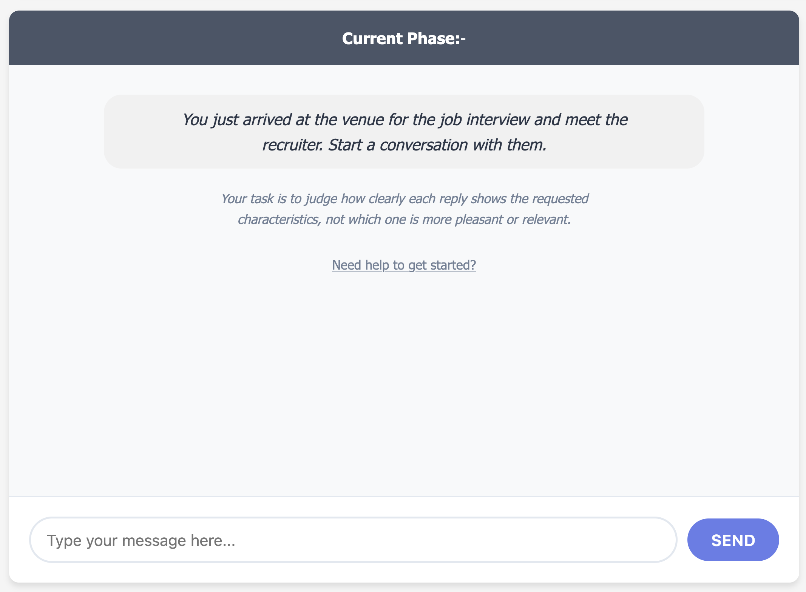
<figcaption>When the chat opens, click <strong>Need help to get started?</strong>, just under the instructions.</figcaption>
</figure>
<figure class="he-fig">
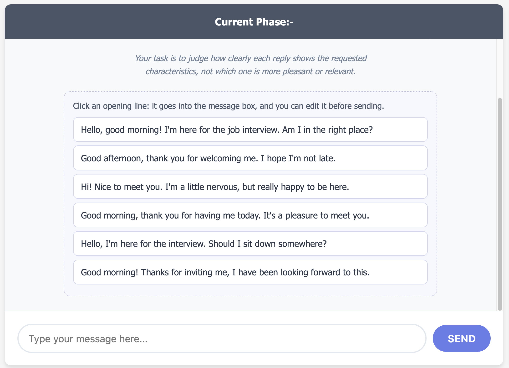
<figcaption>Click a line: it goes into the message box, and you can edit it before sending.</figcaption>
</figure>

**Out of inspiration?** If you don't know what to write during the conversation, the right panel has a **Pick a persona** button that gives you a random character to play, with a desired job and a study and work background. If you don't like the persona you got, click the same button again to get another one. You are free to follow the mentioned characteristics or not, this option is only there in case you need inspiration. It has no influence on how the experiment goes.

<figure class="he-fig">

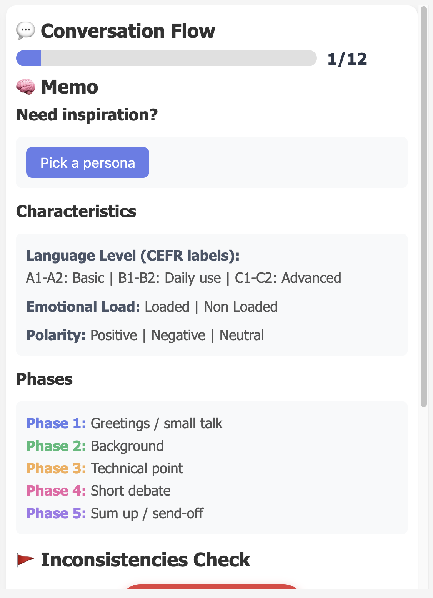

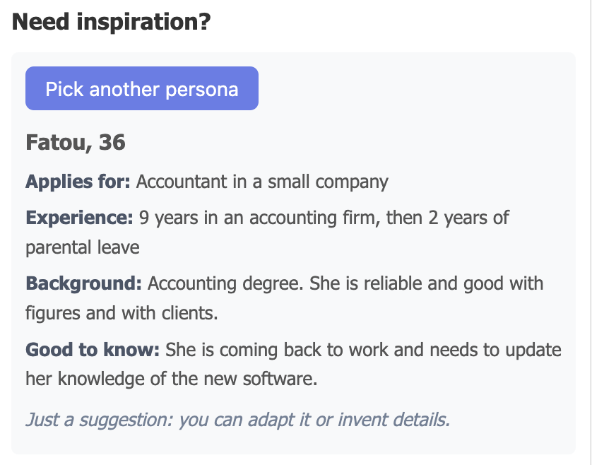
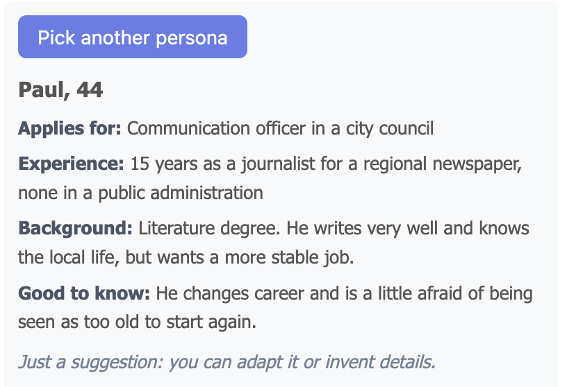

<figcaption>On the left, the right panel with the <strong>Pick a persona</strong> button. On the right, two personas you might get: the button then becomes <strong>Pick another persona</strong>.</figcaption>
</figure>

### When evaluating

If you can't tell the two replies apart with regard to the mentioned characteristics, tick **I can't decide** and confirm. One of the replies will then be picked at random so the conversation can continue. If the two replies are exactly identical, the system detects it automatically and you have nothing to choose. Just answer the agent to carry on with the conversation.

<figure class="he-fig">
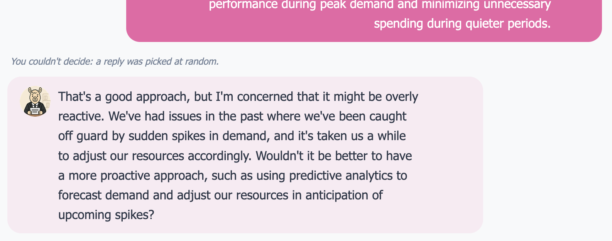
<figcaption>After <strong>I can't decide</strong>, a note above the message tells you that the reply was picked at random.</figcaption>
</figure>

## Flagging a problem {#he-flag}

If the last message from the agent looks off, click **Flag Inconsistency** in the right panel. It doesn't interrupt the interview. You can say that the agent is stuck in the previous phase or jumped to a phase that doesn't fit (phase-level), that it forgot or contradicted something said earlier (context-level), that the text makes no sense, or describe something else in a few words.

<figure class="he-fig">
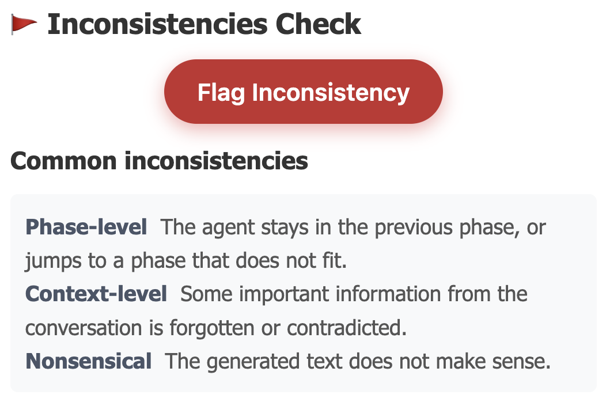
<figcaption>The button is in the right panel, along with a reminder of the most common problems.</figcaption>
</figure>

<figure class="he-fig">
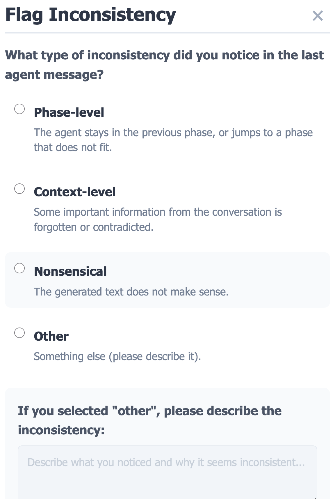
<figcaption>The form that opens: pick a type, or <strong>Other</strong> to describe the problem in your own words.</figcaption>
</figure>

## Good to know {#he-know}

Please don't write personal data such as your name, address or employer. Invent details if you want to.

The agent builds two replies for every message, so waiting is normal. Try not to leave the page idle for too long: after 30 minutes without any action, the conversation is closed.

After the 12th choice, you can leave a comment if you wish, and then close the page. We record your messages, your choices, how long you take, the problems you flag, your comment and the optional "About you" answers. We don't ask for any name or email address. What the comparison is about is explained at the end of the experiment, so that it doesn't influence your choices.

<figure class="he-fig">
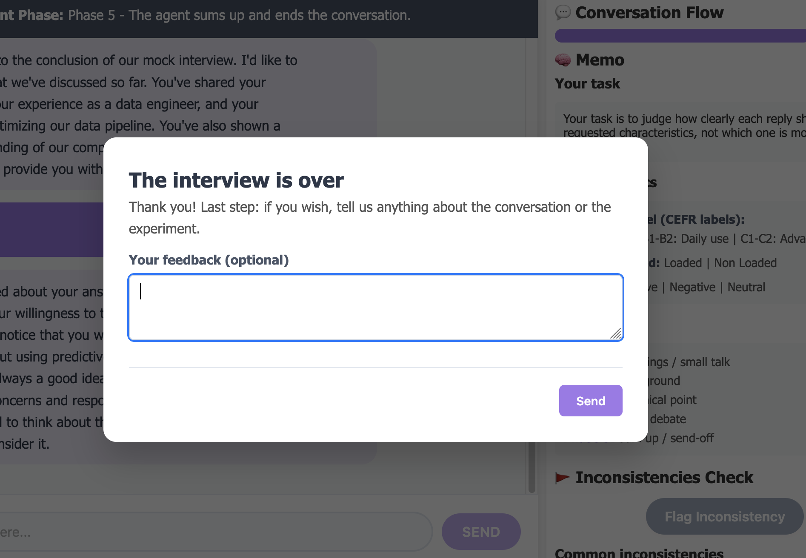
<figcaption>The last screen: the comment is optional.</figcaption>
</figure>

## Take part {#he-contact}

If you'd like to take part, or if you have a question, [get in touch](mailto:barbara.gendron@loria.fr).

## About the research {#he-about}

This study is part of my PhD at LORIA, *Controlled Conversational Models through Conversation-Dedicated Ontology*, supervised by Mathieu d'Aquin (LORIA, CNRS) and Gaël Guibon (LIPN, Université Sorbonne Paris Nord). The thesis explores how to guide a language model with a conversation strategy built from formal concepts and rules, so that its behaviour becomes more predictable and better suited to its use case. The job interview is the prototype setting for that work.

On peut demander à un chatbot de parler d'une certaine manière : dans un anglais simple ou soutenu, sur un ton enthousiaste ou critique, calmement ou avec de l'émotion. Ce qu'on sait moins, c'est s'il le fait vraiment. C'est ce que cette étude cherche à savoir. Vous discutez avec un agent recruteur lors d'un faux entretien d'embauche, et à chaque réponse, vous nous dites laquelle de deux réponses possibles montre le mieux le style que l'agent devait avoir.

Vous envoyez 12 messages au total. Ce n'est pas vous qui êtes évalué mais l'agent, donc il n'y a ni bonne ni mauvaise réponse. Tout est anonyme et volontaire, et vous pouvez arrêter à tout moment en fermant la page.

<a href="#he-before-fr">Avant de commencer</a>
<a href="#he-steps-fr">Déroulé d'un tour</a>
<a href="#he-criteria-fr">Quoi observer</a>
<a href="#he-stuck-fr">En cas de blocage</a>
<a href="#he-flag-fr">Signaler un problème</a>
<a href="#he-know-fr">À savoir</a>
<a href="#he-contact-fr">Participer</a>
<a href="#he-about-fr">À propos de la recherche</a>

<figure class="he-fig">

<figcaption>L'écran pendant un tour. À gauche, le chat, avec la phase en cours en haut et les deux réponses à comparer. À droite, votre progression et un mémo à consulter à tout moment.</figcaption>
</figure>

## Avant de commencer {#he-before-fr}

Lisez l'écran d'information. Un court formulaire « About you » suit (tranche d'âge, niveau d'anglais, expérience des entretiens...). Vous pouvez le passer, et l'agent ne voit jamais vos réponses. Cochez ensuite la case de consentement, cliquez sur **Start the interview** et laissez à la page un instant pour préparer l'entretien.

Une seule personne à la fois peut participer. Si la page indique que quelqu'un d'autre est en cours d'expérience, revenez dans quelques minutes.

<figure class="he-fig">

<figcaption>Remplissez uniquement ce que vous souhaitez, cochez la case de consentement, puis cliquez sur <strong>Start the interview</strong>.</figcaption>
</figure>

## Déroulé d'un tour {#he-steps-fr}

1. Écrivez votre message et envoyez-le. Répondez comme dans un vrai entretien, en quelques phrases.
2. Patientez le temps que l'agent réponde, de quelques secondes à quelques minutes. Si vous rechargez la page, votre conversation est conservée.
3. Au-dessus des deux réponses, une phrase indique le style qu'elles doivent avoir, par exemple *« The agent response is expected to be Positive, Non loaded, B1. »*
4. Lisez les deux réponses. Leur position à gauche ou à droite est aléatoire.
5. Cliquez sur celle qui montre ce style le plus clairement, puis sur **Confirm choice**. La conversation continue avec la réponse choisie.

<figure class="he-fig">

3
4
5

<figcaption>Les étapes 3 à 5 à l'écran : le style demandé, les deux réponses et le bouton pour confirmer.</figcaption>
</figure>

L'agent mène l'entretien en cinq phases, et la phase en cours est toujours affichée en haut du chat. Inutile de les suivre, répondez naturellement.

<figure class="he-fig">

<figcaption>Phase 2 : le bandeau indique la phase en cours et les couleurs suivent. Ici, votre message est en cours de traitement (étape 2).</figcaption>
</figure>
<figure class="he-fig">

<figcaption>Plus tard, en phase 3 : le bandeau et les couleurs ont changé. Vous n'avez rien à faire.</figcaption>
</figure>

<button type="button" class="he-phase he-p1" aria-expanded="false" aria-controls="he-fr-ph1">1 Accueil</button>
<button type="button" class="he-phase he-p2" aria-expanded="false" aria-controls="he-fr-ph2">2 Parcours</button>
<button type="button" class="he-phase he-p3" aria-expanded="false" aria-controls="he-fr-ph3">3 Point technique</button>
<button type="button" class="he-phase he-p4" aria-expanded="false" aria-controls="he-fr-ph4">4 Court débat</button>
<button type="button" class="he-phase he-p5" aria-expanded="false" aria-controls="he-fr-ph5">5 Conclusion</button>

Cliquez sur une phase pour plus de détails.

L'agent vous accueille et fait un peu de conversation pour vous mettre à l'aise. Répondez comme au début d'un vrai entretien.

Messages typiques (à écrire en anglais) :

<ul>
<li><em>"Hi, thanks for having me!"</em></li>
<li><em>"I'm doing well, a bit nervous but happy to be here."</em></li>
<li><em>"Am I at the right place for the interview?"</em></li>
</ul>

L'agent vous interroge sur vos études et votre expérience professionnelle. Vous pouvez parler de parcours réels ou inventés.

Message typique (en anglais) : <em>"I did a master's in marketing, then I spent two years in a small agency running social media campaigns."</em>

L'agent pose une question sur vos compétences et sur la façon dont vous géreriez une situation de travail. Quelques phrases suffisent.

Messages typiques (à écrire en anglais) :

<ul>
<li><em>"I usually start by listing priorities with the team, then I plan the work week by week and check progress regularly."</em></li>
<li><em>"In my last project, I trained a classifier on imbalanced data and used cross-validation to avoid overfitting."</em></li>
</ul>

L'agent défend un point de vue et vous pouvez être d'accord, en désaccord ou nuancer. Peu importe que vos propos correspondent ou non à ce que vous pensez vraiment.

Message typique (en anglais) : <em>"I see your point, but I think working in the office helps newcomers learn faster."</em>

L'agent résume l'entretien et conclut la conversation. Un message de clôture poli suffit.

Message typique (en anglais) : <em>"Thank you for your time, I enjoyed our discussion and I hope to hear from you soon."</em>

## Quoi observer {#he-criteria-fr}

Chaque tour demande une à trois des caractéristiques ci-dessous, et vous ne jugez que celles affichées. La question à garder en tête est de savoir quelle réponse montre le plus clairement le style demandé, quelle que soit votre préférence personnelle. Une réponse aimable et bien écrite peut très bien passer à côté de la cible.

| Caractéristique | Valeurs possibles | Description |
|---|---|---|
| Niveau de langue | A1, A2, B1, B2, C1, C2 | La sophistication de l'anglais, de basique (A1) à avancé (C2).<a href="#he-cefr-fr">1</a> A1 : expressions quotidiennes familières et phrases très basiques. A2 : phrases simples sur des sujets du quotidien comme la famille, les achats ou le travail. B1 : langage standard clair sur des sujets familiers, capable de décrire des expériences et de donner brièvement des raisons et des opinions. B2 : texte clair et détaillé sur une grande variété de sujets, y compris abstraits et techniques, avec des points de vue expliqués. C1 : langage fluide, souple et bien structuré sur des sujets complexes, avec du sens implicite. C2 : tout ou presque exprimé avec aisance, très couramment et précisément, avec des nuances fines. |
| Polarité | Positive, Negative, Neutral | Le sentiment global du texte, comme en analyse de sentiments : le message paraît-il positif, négatif, ou ni l'un ni l'autre ? |
| Charge émotionnelle | Loaded, Non loaded | Indique si le texte montre une émotion perceptible (Loaded) ou aucune (Non loaded). |

1 Descriptions des niveaux résumées à partir du <a href="https://www.coe.int/en/web/common-european-framework-reference-languages/level-descriptions">Cadre européen commun de référence pour les langues (CECR)</a>, Conseil de l'Europe (site en anglais).

*Neutral* et *Non loaded* décrivent l'absence de sentiment ou d'émotion : il faut donc choisir la réponse la plus sobre et la plus factuelle.

## En cas de blocage {#he-stuck-fr}

### Au cours de la conversation

**Difficile de démarrer ?** Dans cette expérience, c'est vous qui entamez la conversation. Si besoin, cliquez sur **Need help to get started?** pour que l'on vous propose quelques phrases d'ouverture. Sélectionnez celle qui vous convient, modifiez-la si vous le souhaitez et envoyez le message. L'utilisation d'une des phrases proposées n'aura aucune influence sur le déroulé de l'expérience.

<figure class="he-fig">

<figcaption>À l'ouverture du chat, cliquez sur <strong>Need help to get started?</strong>, juste sous les consignes.</figcaption>
</figure>
<figure class="he-fig">

<figcaption>Cliquez sur une phrase : elle va dans la zone de message, et vous pouvez la modifier avant de l'envoyer.</figcaption>
</figure>

**En panne d'inspiration ?** Si vous ne savez pas quoi écrire au cours de la conversation, le panneau de droite propose un bouton **Pick a persona** qui vous donne un personnage tiré au hasard à incarner, avec un métier souhaité, un parcours d'études et un parcours professionnel. Si le personnage tiré aléatoirement ne vous convient pas, vous pouvez en avoir un autre en cliquant à nouveau sur le même bouton. Vous pouvez tout à fait décider de suivre ou non les caractéristiques mentionnées, cette option est simplement là si vous avez besoin d'inspiration. Cela n'aura aucune influence sur le déroulé de l'expérience.

<figure class="he-fig">

<figcaption>À gauche, le panneau de droite avec le bouton <strong>Pick a persona</strong>. À droite, deux personnages que vous pourriez obtenir : le bouton devient alors <strong>Pick another persona</strong>.</figcaption>
</figure>

### Au moment de l'évaluation

Si vous n'arrivez pas à départager les deux réponses par rapport au respect des caractéristiques mentionnées, cochez **I can't decide** et confirmez. Une réponse sera alors tirée au hasard pour permettre de continuer la conversation. Dans le cas où les deux réponses sont parfaitement identiques, le système le détectera automatiquement. Dans ce cas vous n'aurez rien à choisir. Répondez simplement à l'agent pour poursuivre la conversation.

<figure class="he-fig">

<figcaption>Après <strong>I can't decide</strong>, une note au-dessus du message vous indique que la réponse a été tirée au hasard.</figcaption>
</figure>

## Signaler un problème {#he-flag-fr}

Si le dernier message de l'agent vous paraît anormal, cliquez sur **Flag Inconsistency** dans le panneau de droite. Cela n'interrompt pas l'entretien. Vous pouvez indiquer que l'agent reste bloqué dans la phase précédente ou saute vers une phase inadaptée (phase-level), qu'il oublie ou contredit quelque chose dit plus tôt (context-level), que le texte n'a pas de sens, ou décrire autre chose en quelques mots.

<figure class="he-fig">

<figcaption>Le bouton se trouve dans le panneau de droite, avec un rappel des problèmes les plus courants.</figcaption>
</figure>

<figure class="he-fig">

<figcaption>Le formulaire qui s'ouvre : choisissez un type, ou <strong>Other</strong> pour décrire le problème avec vos mots.</figcaption>
</figure>

## À savoir {#he-know-fr}

Merci de ne pas écrire de données personnelles comme votre nom, votre adresse ou votre employeur. Inventez des détails si vous le souhaitez.

L'agent construit deux réponses pour chaque message, donc l'attente est normale. Évitez simplement de laisser la page inactive trop longtemps : après 30 minutes sans action, la conversation est fermée.

Après le 12e choix, vous pouvez laisser un commentaire si vous le souhaitez, puis fermer la page. Nous enregistrons vos messages, vos choix, votre temps de réponse, les problèmes signalés, votre commentaire et les réponses facultatives à « About you ». Aucun nom ni adresse email n'est demandé. L'objet de la comparaison est expliqué à la fin de l'expérience, pour ne pas influencer vos choix.

<figure class="he-fig">

<figcaption>Le dernier écran : le commentaire est facultatif.</figcaption>
</figure>

## Participer {#he-contact-fr}

Si vous souhaitez participer, ou si vous avez une question, [contactez-moi](mailto:barbara.gendron@loria.fr).

## À propos de la recherche {#he-about-fr}

Cette étude s'inscrit dans ma thèse au LORIA, *Controlled Conversational Models through Conversation-Dedicated Ontology*, encadrée par Mathieu d'Aquin (LORIA, CNRS) et Gaël Guibon (LIPN, Université Sorbonne Paris Nord). La thèse explore comment guider un modèle de langage avec une stratégie conversationnelle construite à partir de concepts et de règles formalisés, afin que son comportement soit plus prévisible et mieux adapté à son cas d'usage. L'entretien d'embauche est le cadre du prototype développé dans ce travail.

